# Navmesh since 0.686

What the navmesh rewrite changed, measured on six plugins on 2026-11-11: release 0.686 against the
current code, both cold (no navmesh cache), on a 16-core / 32-thread Ryzen 7950X3D.

| All six plugins | 0.686 | Now | Change |
|---|---|---|---|
| Navmesh time, total | 67 min | **34 min** | **-49%** |
| Cells with navmesh | 22,744 | **39,075** | **+72%** |
| Time per navmeshed cell | 0.176 s | **0.052 s** | **-71%** |
| Walkable area per cell (cells both build) | | | **+13.2%** |
| Area added in newly navmeshed cells | | **39 km²** | |
| Peak RAM in use (largest: Morroblivion) | 22.5 GB | **19.2 GB** | **-15%** |
| Peak committed memory (largest: Morroblivion) | 70 GB | **24 GB** | **-65%** |

The same measures per plugin. The last row averages the six plugins' values, and its percentages
compare those averages:

| | Navmesh time | Cells with navmesh | Time per navmeshed cell | Walkable area per cell | Area added in new cells | Peak RAM in use | Peak committed memory |
|---|---|---|---|---|---|---|---|
| Oblivion | 27.7 → **10.4 min** (-62%) | 8,212 → **8,987** (+9%) | 0.202 → **0.070 s** (-66%) | **+9.7%** | 2.4 km² | 14.9 → **14.3 GB** (-4%) | 59 → **16 GB** (-73%) |
| Nehrim | 14.8 → **4.8 min** (-67%) | 2,922 → **3,769** (+29%) | 0.305 → **0.077 s** (-75%) | **+15.1%** | 1.9 km² | 10.4 → **10.2 GB** (-2%) | 55 → **13 GB** (-77%) |
| Morroblivion | 11.1 → **5.3 min** (-53%) | 5,277 → **6,237** (+18%) | 0.127 → **0.051 s** (-60%) | **+12.1%** | 2.9 km² | 22.5 → **19.2 GB** (-15%) | 70 → **24 GB** (-65%) |
| Morrowind | 2.1 → **3.3 min** (+60%) | 1,417 → **5,199** (+267%) | 0.088 → **0.038 s** (-56%) | **+1.5%** | 9.5 km² | 5.8 → **3.3 GB** (-43%) | 50 → **5 GB** (-90%) |
| Arktwend | 1.0 → **2.9 min** (+176%) | 857 → **3,205** (+274%) | 0.073 → **0.054 s** (-26%) | **+70.0%** | 5.4 km² | 6.6 → **4.5 GB** (-33%) | 51 → **7 GB** (-86%) |
| TR Mainland | 10.0 → **7.1 min** (-29%) | 4,059 → **11,678** (+188%) | 0.147 → **0.036 s** (-75%) | **+65.4%** | 17.1 km² | 18.8 → **12.4 GB** (-34%) | 63 → **14 GB** (-78%) |
| **Average** | 11.1 → **5.6 min** (-49%) | 3,791 → **6,512** (+72%) | 0.157 → **0.054 s** (-65%) | **+13.2%** | 6.5 km² | 13.2 → **10.6 GB** (-19%) | 58 → **13 GB** (-77%) |

More detail per plugin:

| | Cells with navmesh | Walkable area on cells both build | Cracks per km² (same cells) | Navmesh time, whole plugin | Peak RAM in use |
|---|---|---|---|---|---|
| **Oblivion** | 8,212 → **8,987** (+9%) | +9.7% | 90 → **83** | 27.7 → **10.4 min** | 14.9 → **14.3 GB** |
| **Nehrim** | 2,922 → **3,769** (+29%) | +15.1% | 176 → **116** | 14.8 → **4.8 min** | 10.4 → **10.2 GB** |
| **Morroblivion** | 5,277 → **6,237** (+18%) | +12.1% | 35 → **39** | 11.1 → **5.3 min** | 22.5 → **19.2 GB** |
| **Morrowind** ¹ | 1,417 → **5,199** (+267%) | +1.5% | 283 → **161** | 2.1 → **3.3 min** | 5.8 → **3.3 GB** |
| **Arktwend** ¹ | 857 → **3,205** (+274%) | +70.0% | 100 → **71** | 1.0 → **2.9 min** | 6.6 → **4.5 GB** |
| **TR Mainland** ¹ | 4,059 → **11,678** (+188%) | +65.4% | 186 → **120** | 10.0 → **7.1 min** | 18.8 → **12.4 GB** |

¹ Morrowind, Arktwend and TR Mainland compare an even 800-cell sample; the other three compare every cell.
Cracks are per km² because coverage grew: more navmesh has more edge where a crack can occur.

```mermaid
xychart-beta
    title "Cells with a navmesh"
    x-axis ["Oblivion", "Nehrim", "Morroblivion", "Morrowind", "Arktwend", "TR Mainland"]
    y-axis "cells" 0 --> 13430
    bar [8212.0, 2922.0, 5277.0, 1417.0, 857.0, 4059.0]
    bar [8987.0, 3769.0, 6237.0, 5199.0, 3205.0, 11678.0]
```

*bar 1: 0.686 · bar 2: now*

## Coverage

Cells with no pathgrid now get navmesh too: the build floods outward from neighbouring navmesh and
from the open ground the pathgrid's mesh leaves, over several rounds.

| | Cells 0.686 | Cells now | Newly navmeshed | Area of new cells | Cells reached by flood/seeding |
|---|---|---|---|---|---|
| Oblivion | 8,212 | 8,987 | +775 | 2.40 km² | 5,909 |
| Nehrim | 2,922 | 3,769 | +847 | 1.85 km² | 2,760 |
| Morroblivion | 5,277 | 6,237 | +960 | 2.87 km² | 4,052 |
| Morrowind | 1,417 | 5,199 | +3,783 | 9.49 km² | 4,056 |
| Arktwend | 857 | 3,205 | +2,348 | 5.36 km² | 2,679 |
| TR Mainland | 4,059 | 11,678 | +7,620 | 17.14 km² | 8,240 |

## Quality (cells both versions build)

| | Compared cells | Area | Triangles | Islands (pieces per cell, summed) | Cracks | Cracks per km² | Slivers per 1k tris |
|---|---|---|---|---|---|---|---|
| Oblivion | 8,212 | +9.7% | +12.6% | 11,704 → 12,862 | 1,476 → 1,486 | 90 → **83** (-8%) | 7.2 → 7.6 |
| Nehrim | 2,922 | +15.1% | +17.6% | 5,966 → 5,908 | 655 → 499 | 176 → **116** (-34%) | 8.0 → 8.8 |
| Morroblivion | 5,277 | +12.1% | +13.3% | 9,152 → 9,863 | 345 → 436 | 35 → **39** (+13%) | 4.5 → 5.1 |
| Morrowind | 800 | +1.5% | +1.0% | 1,112 → 1,106 | 85 → 49 | 283 → **161** (-43%) | 1.7 → 2.5 |
| Arktwend | 798 | +70.0% | +62.3% | 1,332 → 1,356 | 79 → 96 | 100 → **71** (-29%) | 6.0 → 8.7 |
| TR Mainland | 800 | +65.4% | +33.3% | 1,314 → 1,354 | 69 → 74 | 186 → **120** (-35%) | 2.8 → 4.0 |

*Cracks: an open-edge vertex lying on another open edge it is not joined to (the gap that stops an
actor walking across). Islands: pieces joined through shared edges, summed per navmesh.*

Standing checks on a sample of cells (`engine_check`'s rules, per 1,000 triangles):

| | Cells checked | Floating (no floor under it) | Inside an object | Low headroom |
|---|---|---|---|---|
| Oblivion | 16 | 0.8 → **0.7** | 1.2 → **1.3** | 10.4 → **10.7** |
| Nehrim | 16 | 17.8 → **11.3** | 1.5 → **1.4** | 16.3 → **17.4** |
| Morrowind | 8 | 17.9 → **11.5** | 1.2 → **1.8** | 5.6 → **6.5** |

## Seams and doors (current build)

| | Navmeshes | Exterior navmeshes linked to a neighbour | Seam links | Door triangles | Ledge drops |
|---|---|---|---|---|---|
| Oblivion | 9,640 | 7,286 / 7,314 (99.6%) | 307,322 | 6,590 | 696 |
| Nehrim | 3,986 | 3,114 / 3,148 (98.9%) | 88,660 | 2,506 | 576 |
| Morroblivion | 6,509 | 4,891 / 4,918 (99.5%) | 210,760 | 5,412 | 248 |
| Morrowind | 5,452 | 4,073 / 4,074 (100.0%) | 169,410 | 4,044 | 184 |
| Arktwend | 3,513 | 2,811 / 2,817 (99.8%) | 105,114 | 1,429 | 152 |
| TR Mainland | 12,956 | 8,313 / 8,331 (99.8%) | 313,614 | 13,268 | 608 |

## Time and memory

```mermaid
xychart-beta
    title "Navmesh time per plugin (minutes)"
    x-axis ["Oblivion", "Nehrim", "Morroblivion", "Morrowind", "Arktwend", "TR Mainland"]
    y-axis "minutes" 0 --> 32
    bar [27.7, 14.8, 11.1, 2.1, 1.0, 10.0]
    bar [10.4, 4.8, 5.3, 3.3, 2.9, 7.1]
```

*bar 1: 0.686 · bar 2: now*

| | 0.686 (29 processes) | Now: first pass | Now: flood rounds | Now: total | Cells per second |
|---|---|---|---|---|---|
| Oblivion | 27.7 min (4.9/s) | 4.6 min | 4.9 min over 24 rounds | **10.4 min** | 14.4 |
| Nehrim | 14.8 min (3.3/s) | 2.0 min | 2.6 min over 13 rounds | **4.8 min** | 13.0 |
| Morroblivion | 11.1 min (7.9/s) | 1.9 min | 2.6 min over 9 rounds | **5.3 min** | 19.7 |
| Morrowind | 2.1 min (11.4/s) | 0.3 min | 2.8 min over 27 rounds | **3.3 min** | 26.2 |
| Arktwend | 1.0 min (13.7/s) | 0.7 min | 2.0 min over 35 rounds | **2.9 min** | 18.7 |
| TR Mainland | 10.0 min (6.8/s) | 1.0 min | 5.4 min over 30 rounds | **7.1 min** | 27.5 |

```mermaid
xychart-beta
    title "Peak RAM in use (GB)"
    x-axis ["Oblivion", "Nehrim", "Morroblivion", "Morrowind", "Arktwend", "TR Mainland"]
    y-axis "GB" 0 --> 26
    bar [14.9, 10.4, 22.5, 5.8, 6.6, 18.8]
    bar [14.3, 10.2, 19.2, 3.3, 4.5, 12.4]
```

*bar 1: 0.686 · bar 2: now*

| | Peak RAM in use | Peak committed memory |
|---|---|---|
| Oblivion | 14.9 → **14.3 GB** | 59 → **16 GB** |
| Nehrim | 10.4 → **10.2 GB** | 55 → **13 GB** |
| Morroblivion | 22.5 → **19.2 GB** | 70 → **24 GB** |
| Morrowind | 5.8 → **3.3 GB** | 50 → **5 GB** |
| Arktwend | 6.6 → **4.5 GB** | 51 → **7 GB** |
| TR Mainland | 18.8 → **12.4 GB** | 63 → **14 GB** |

RAM in use is the whole conversion process during the navmesh step (0.686: the parent plus its 29
worker processes; now: one process running 29 threads), including the plugin's parsed records. It is
about the same or lower now. Committed memory, Task Manager's "Commit size", is memory claimed whether
or not it is in RAM; running out of it is the "paging file too small" error. 0.686's workers each
claimed ~1.7 GB of it, so it is 3–10× lower now.

## How this was measured

- **Before:** Oblivion, Nehrim and Morroblivion from the published `navmesh-cache-0.685+` release
  (0.686's geometry for every cell); Morrowind, Arktwend and TR Mainland by running 0.686 on an even
  800-cell sample. 0.686's time is that sample on its own 29-process pool, scaled to every cell; it had
  no flood rounds.
- **After:** the import's whole navmesh phase per plugin (first pass, every flood round, seams, interior
  split), every cell built cold. Repeated runs agreed within about 12%.
- Per-navmesh counts, summed per cell; split interiors count each piece.
- Known issue found while measuring: the current build ships duplicate triangles (the same three
  vertices twice) in some meshes, 412 across 63 of Nehrim's 3,986 navmeshes against 1 in 0.686.
